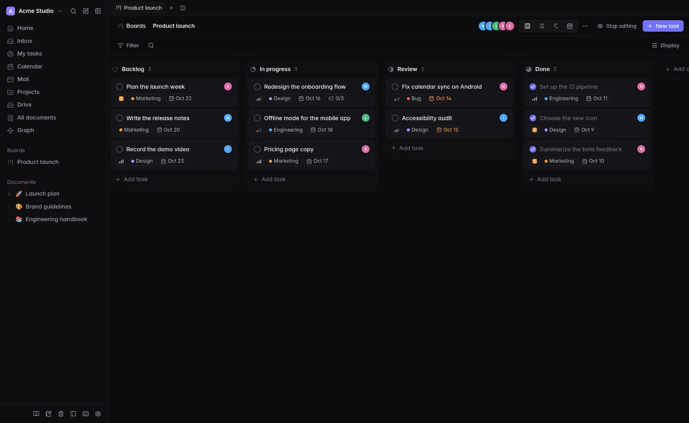

<p align="center">
  
</p>

<h1 align="center">Looty</h1>

<p align="center">
  Tasks, documents and calendar for your team, in one calm place.<br>
  Free, open source and self-hosted, with apps for Android, Linux and Windows that work offline.
</p>

<p align="center">
  <a href="https://looty.untypequicode.fr">Website and downloads</a> ·
  <a href="RELEASING.md">Releasing</a> ·
  <a href="LICENSE">GPL-3.0</a>
</p>

<p align="center">
  
</p>

## What it does

- **Boards and tasks**: kanban, list, timeline and calendar views; assignees, labels, priorities, due dates, sub-tasks and per-person validation.
- **Documents**: collaborative editing with live cursors, formulas (LaTeX), diagrams, tables, code and embeds; share by link or with chosen people.
- **Calendar**: events and recurrence, a calendar per board, CalDAV subscriptions and a CalDAV server; task due dates appear on it.
- **Mail**: read your mailbox next to your work and turn a message into a task.
- **Projects**: small websites, LaTeX documents and Jupyter notebooks running Python in the browser, or on your own Jupyter server.
- **School**: connect Moodle to see deadlines, courses and messages beside your own tasks.
- **Teams**: fine-grained roles, read-only members, guests, single sign-on (OpenID Connect), activity feed, notifications.
- **Offline apps**: Android, Linux and Windows keep your data on the device, let you edit offline and sync back.

English and French, light and dark themes.

## Apps

Download them from **<https://looty.untypequicode.fr>** (or the [GitHub releases](../../releases)). Each app asks for the address of *your* Looty server.

| Platform | Notes |
|---|---|
| Android 8+ | Native Kotlin app, no Google services (UnifiedPush), widget, share target, offline editing, updates inside the app |
| Linux | `.deb` for Debian 12 / Ubuntu 22.04+ with a signed apt repository (`apt upgrade` updates it); Nix package (`nix run github:untypequicode/looty#looty-desktop`) |
| Windows 10/11 | Installer for the current user (unsigned: Windows may warn about an unknown publisher) |
| iPhone / iPad | Open Looty in Safari and add it to the home screen (installable web app) |

### Nix: use the binary cache

The desktop app and the dev shells are prebuilt for x86_64 and aarch64 Linux in the `looty` Cachix cache, so Nix downloads instead of compiling. The flake declares the cache; Nix only honours that if your user is trusted, so on NixOS add it to your configuration once:

```nix
nix.settings = {
  extra-substituters = [ "https://looty.cachix.org" ];
  extra-trusted-public-keys = [ "looty.cachix.org-1:xEEH96rXQvBMpS4Flzu1yAfe1Wt4Pz2nKssc1ga5eYc=" ];
};
```

Elsewhere, put the same two lines in `/etc/nix/nix.conf`. Without this, Nix warns *ignoring the client-specified setting 'trusted-public-keys'* and builds locally. Then `nix run github:untypequicode/looty#looty-desktop`.

## Self-hosting

Looty is three small services plus PostgreSQL, shipped as Docker images (amd64 and arm64):

| Service | Role | Stack |
|---|---|---|
| `backend` | API, files, CalDAV, mail | Rust (axum) |
| `frontend` | Web interface | Nuxt 3 |
| `collaboration` | Real-time document editing | Hocuspocus (Yjs) |

1. Get the files of the latest release and create a `.env` next to them. **Without a reverse proxy**, take the variant with [Caddy](https://caddyserver.com) included (automatic HTTPS with Let's Encrypt; ports 80 and 443 must be free and the domain must point to the machine):

   ```sh
   curl -L -o docker-compose.yml https://github.com/untypequicode/looty/releases/latest/download/docker-compose.caddy.yml
   curl -LO https://github.com/untypequicode/looty/releases/latest/download/Caddyfile
   curl -o .env https://raw.githubusercontent.com/untypequicode/looty/main/.env.example
   ```

   **Behind an existing [Traefik](https://traefik.io)**, take only the compose file (routing is in its labels). The labels set no entry point or certificate: Traefik must reach the stack's network and serve HTTPS on its entry points (for example `--entrypoints.websecure.http.tls.certResolver=<resolver>`); `deploy/test/stack.sh traefik` shows a working setup.

   ```sh
   curl -LO https://github.com/untypequicode/looty/releases/latest/download/docker-compose.yml
   curl -o .env https://raw.githubusercontent.com/untypequicode/looty/main/.env.example
   ```

2. Edit `.env`: the domain (`APP_DOMAIN`, and `BASE_URL=https://<domain>`), database password, `LOOTY_SECRET_KEY` (`openssl rand -base64 32`) and your OpenID Connect provider (`OIDC_ISSUER`, `OIDC_CLIENT_ID`, `OIDC_CLIENT_SECRET`). Optionally set `OIDC_PROVIDER_ID` to a UUID (`uuidgen`) to know the redirect URL, `<BASE_URL>/api/auth/callback/<UUID>`, before the first start.
3. `docker compose up -d`.

**No identity provider? Bundled Pocket ID.** The `*.pocket-id.*` files add [Pocket ID](https://pocket-id.org) (sign-in with passkeys) on its own subdomain, `auth.<domain>`, already linked to Looty: on every start, the one-shot `pocket-id-init` service creates Looty's OIDC client in Pocket ID (and changes nothing if it exists).

1. Point the DNS of `auth.<domain>` to the server too, then take the files (with Caddy; behind Traefik, `docker-compose.pocket-id.yml` and no Caddyfile):

   ```sh
   curl -L -o docker-compose.yml https://github.com/untypequicode/looty/releases/latest/download/docker-compose.caddy.pocket-id.yml
   curl -L -o Caddyfile https://github.com/untypequicode/looty/releases/latest/download/Caddyfile.pocket-id
   curl -LO https://github.com/untypequicode/looty/releases/latest/download/pocket-id-init.sh
   curl -o .env https://raw.githubusercontent.com/untypequicode/looty/main/.env.example
   ```

2. In `.env`, besides the domain, database and `LOOTY_SECRET_KEY`, replace the OIDC block with:

   ```sh
   AUTH_DOMAIN=auth.<domain>
   OIDC_ISSUER=https://auth.<domain>
   OIDC_CLIENT_ID=looty
   OIDC_CLIENT_SECRET=<openssl rand -hex 32>
   OIDC_PROVIDER_ID=<uuidgen>
   POCKET_ID_ENCRYPTION_KEY=<openssl rand -base64 32>
   POCKET_ID_STATIC_API_KEY=<openssl rand -hex 32>
   ```

3. `docker compose up -d`, then `docker compose logs pocket-id-init` should end with `prêt`.
4. **Right away**, open `https://auth.<domain>/setup` and create your account, **with your email address** (Looty needs it), then add a passkey. Until this account exists, whoever opens that page first becomes the Pocket ID administrator.
5. Sign in to Looty with « Continuer avec SSO »: as the first account, you are Looty's administrator. Add other people in Pocket ID (Administration > Users).

Behind Traefik, Looty reaches `https://auth.<domain>` through the host (`extra_hosts: host-gateway` in the compose file): Traefik must listen on port 443 of the host (with Caddy, the compose file routes this internally). `POCKET_ID_STATIC_API_KEY` is an admin key for Pocket ID: once the client exists you may remove it from `.env` (`pocket-id-init` then does nothing). A provider whose certificate comes from an internal authority needs `OIDC_CA_FILE` (PEM file, mounted into the backend).

**If the automatic setup fails** (Looty's sign-in page says the provider can't be reached or rejected Looty, or `pocket-id-init` exited with an error), read `docker compose logs pocket-id-init backend`, fix the cause and run `docker compose up -d` again. Or create the client by hand, as for any provider:

1. In Pocket ID (after `/setup`): Administration > OIDC Clients > Add. Name `Looty`, callback URL `<BASE_URL>/api/auth/callback/<OIDC_PROVIDER_ID>` (exactly), PKCE on. Save, and copy the client ID and secret.
2. Give them to Looty: `docker compose exec postgres psql -U <DB_USER> -d <DB_NAME> -c "UPDATE oauth_providers SET client_id = '<client ID>', client_secret = '<secret>' WHERE id = '<OIDC_PROVIDER_ID>'"`, then `docker compose restart backend`. (Looty reads the `OIDC_*` variables only on its very first start; afterwards, the provider is edited in Administration > Authentication providers.)

Behind another proxy, use the Traefik compose file and send `/api`, `/uploads`, `/pages`, `/dav` and `/.well-known/caldav` to the backend (8080), `/collab` to the collaboration service (8082, prefix stripped) and everything else to the frontend (3000), WebSockets included; the `Caddyfile` is a working example. Pin a version with `LOOTY_VERSION=<x.y.z>`. These files are rendered from `deploy/templates/` by `deploy/render.sh` (`docker-compose.prod.yml` is the Traefik output); edit the templates, not the rendered files.

Backups: `scripts/backup.sh` and `scripts/restore.sh`.

**Where the database lives.** PostgreSQL's data is stored in the folder `./data/postgres`, next to the compose file (set `LOOTY_DB_DATA` in `.env` to an absolute path to put it elsewhere). Back it up by stopping the stack and copying that folder, or with `pg_dump`.

**Move the database** (installations that still use the old Docker volume `postgres_data_18`: **do not just pull**, the new compose file would start on an empty database). From the folder of your compose file:

```sh
docker compose exec -T postgres pg_dump -U "$DB_USER" -Fc "$DB_NAME" > looty-backup.dump   # safety net
docker compose down                                                                          # never with -v
VOL=$(docker volume ls -q | grep postgres_data_18)                                           # e.g. looty_postgres_data_18
mkdir -p data/postgres
docker run --rm -v "$VOL":/from -v "$PWD/data/postgres":/to alpine cp -a /from/. /to/
docker compose up -d
```

The old volume is left untouched: delete it (`docker volume rm "$VOL"`) once everything works. To put the data in another folder, set `LOOTY_DB_DATA=/that/folder` in `.env` and copy into it instead.

**Public demo.** To run a demo (visitors pick a character and get a throwaway copy of the « Looty Demo » workspace, deleted after 24 h), use `docker-compose.demo.yml` and `.env.demo.example` in their own folder: a separate stack (`looty-demo`, own database and volumes) that can run next to a real instance. It needs no OIDC provider and no SMTP.

## Repository

```
backend/         Rust API (axum, PostgreSQL); release notes in releases.json
frontend/        Nuxt 3 single-page app
collaboration/   Hocuspocus server for real-time documents
desktop/         Tauri v2 app (Linux, Windows) and Debian packaging
android/         Native Android app (Kotlin, Compose)
site/            Download website (Astro + a tiny Rust server)
scripts/         Release, backup and site publishing scripts
```

## Development

A Nix shell provides every toolchain: `nix-shell` (or `nix develop`).

```sh
docker compose up -d postgres          # database
cd backend && cargo run                # API on :8080
cd frontend && npm install && npm run dev   # web app on :3000
cd collaboration && npm install && node index.js
```

`docker compose up` (without Traefik) builds and runs everything from source; add `docker-compose.override.yml.example` as `docker-compose.override.yml` to reach it on port 3000 (the frontend also relays the `/api/ws` and `/collab` WebSockets, so real-time editing works without a proxy). Checks run by CI: `cargo test` in `backend/`, `node scripts/check-i18n.mjs` (French and English texts match) and `npm run build` in `frontend/`. Each app has its own README: [`desktop/`](desktop/README.md), [`android/`](android/README.md), [`site/`](site/README.md).

## Releasing

Bump the version, add the notes (English and French) to `backend/releases.json` and merge into `main`: CI builds and publishes what changed. Details in [RELEASING.md](RELEASING.md).

## License

[GPL-3.0](LICENSE).
