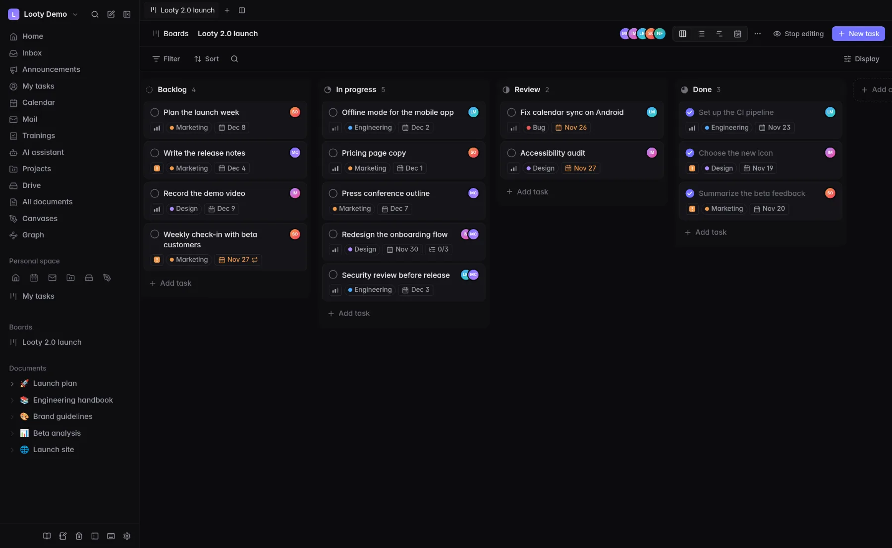

<p align="center">
  
</p>

<h1 align="center">Looty</h1>

<p align="center">
  Tasks, documents and calendar for your team, in one calm place.<br>
  Free, open source and self-hosted, with apps for Android, Linux and Windows that work offline.
</p>

<p align="center">
  <a href="https://looty.untypequicode.fr">Website and downloads</a> ·
  <a href="RELEASING.md">Releasing</a> ·
  <a href="LICENSE">GPL-3.0</a>
</p>

<p align="center">
  
</p>

## What it does

- **Boards and tasks**: kanban, list, timeline and calendar views; assignees, labels, priorities, due dates, sub-tasks and per-person validation.
- **Documents**: collaborative editing with live cursors, formulas (LaTeX), diagrams, tables, code and embeds; share by link or with chosen people.
- **Calendar**: events and recurrence, a calendar per board, CalDAV subscriptions and a CalDAV server; task due dates appear on it.
- **Mail**: read your mailbox next to your work and turn a message into a task.
- **Projects**: small websites, LaTeX documents and Jupyter notebooks running Python in the browser, or on your own Jupyter server.
- **School**: connect Moodle to see deadlines, courses and messages beside your own tasks.
- **Teams**: fine-grained roles, read-only members, guests, single sign-on (OpenID Connect), activity feed, notifications.
- **Offline apps**: Android, Linux and Windows keep your data on the device, let you edit offline and sync back.

English and French, light and dark themes.

## Apps

Download them from **<https://looty.untypequicode.fr>** (or the [GitHub releases](../../releases)). Each app asks for the address of *your* Looty server.

| Platform | Notes |
|---|---|
| Android 8+ | Native Kotlin app, no Google services (UnifiedPush), widget, share target, offline editing, updates inside the app |
| Linux | `.deb` for Debian 12 / Ubuntu 22.04+ with a signed apt repository (`apt upgrade` updates it); Nix package (`nix run github:untypequicode/looty#looty-desktop`) |
| Windows 10/11 | Installer for the current user (unsigned: Windows may warn about an unknown publisher) |
| iPhone / iPad | Open Looty in Safari and add it to the home screen (installable web app) |

### Nix: use the binary cache

The desktop app and the dev shells are prebuilt for x86_64 and aarch64 Linux in the `looty` Cachix cache, so Nix downloads instead of compiling. The flake declares the cache; Nix only honours that if your user is trusted, so on NixOS add it to your configuration once:

```nix
nix.settings = {
  extra-substituters = [ "https://looty.cachix.org" ];
  extra-trusted-public-keys = [ "looty.cachix.org-1:xEEH96rXQvBMpS4Flzu1yAfe1Wt4Pz2nKssc1ga5eYc=" ];
};
```

Elsewhere, put the same two lines in `/etc/nix/nix.conf`. Without this, Nix warns *ignoring the client-specified setting 'trusted-public-keys'* and builds locally. Then `nix run github:untypequicode/looty#looty-desktop`.

## Self-hosting

Looty is three small services plus PostgreSQL, shipped as Docker images (amd64 and arm64): `backend` (Rust API), `frontend` (Nuxt web interface) and `collaboration` (Hocuspocus real-time editing).

The full guide lives in the documentation, in English and French:

- **[Host Looty](https://looty.untypequicode.fr/docs/host/)**: requirements, quick and detailed install (Caddy, Traefik, another proxy), sign-in (OpenID Connect providers, bundled Pocket ID), email, push, Moodle, Jupyter, backups, updates, PostgreSQL upgrades, troubleshooting and security.
- **[Environment variables reference](https://looty.untypequicode.fr/docs/reference/environment/)**, generated from `docs/env-vars.json` (which also generates `.env.example`; `node scripts/env-reference.mjs --write` regenerates them and CI checks them against the code).

The compose files are rendered from `deploy/templates/` by `deploy/render.sh`: edit the templates, not the rendered files. A public demo uses `docker-compose.demo.yml` and `.env.demo.example` in a separate stack. The documentation sources are in `site/web/src/content/docs/`.

## Repository

```
backend/         Rust API (axum, PostgreSQL); release notes in releases.json
frontend/        Nuxt 3 single-page app
collaboration/   Hocuspocus server for real-time documents
desktop/         Tauri v2 app (Linux, Windows) and Debian packaging
android/         Native Android app (Kotlin, Compose)
site/            Download website (Astro + a tiny Rust server)
scripts/         Release, backup and site publishing scripts
```

## Development

A Nix shell provides every toolchain: `nix-shell` (or `nix develop`).

```sh
docker compose up -d postgres          # database
cd backend && cargo run                # API on :8080
cd frontend && npm install && npm run dev   # web app on :3000
cd collaboration && npm install && node index.js
```

`docker compose up` (without Traefik) builds and runs everything from source; add `docker-compose.override.yml.example` as `docker-compose.override.yml` to reach it on port 3000 (the frontend also relays the `/api/ws` and `/collab` WebSockets, so real-time editing works without a proxy). Checks run by CI: `cargo test` in `backend/`, `node scripts/check-i18n.mjs` (French and English texts match) and `npm run build` in `frontend/`. Each app has its own README: [`desktop/`](desktop/README.md), [`android/`](android/README.md), [`site/`](site/README.md).

## Releasing

Bump the version, add the notes (English and French) to `backend/releases.json` and merge into `main`: CI builds and publishes what changed. Details in [RELEASING.md](RELEASING.md).

## License

[GPL-3.0](LICENSE).
