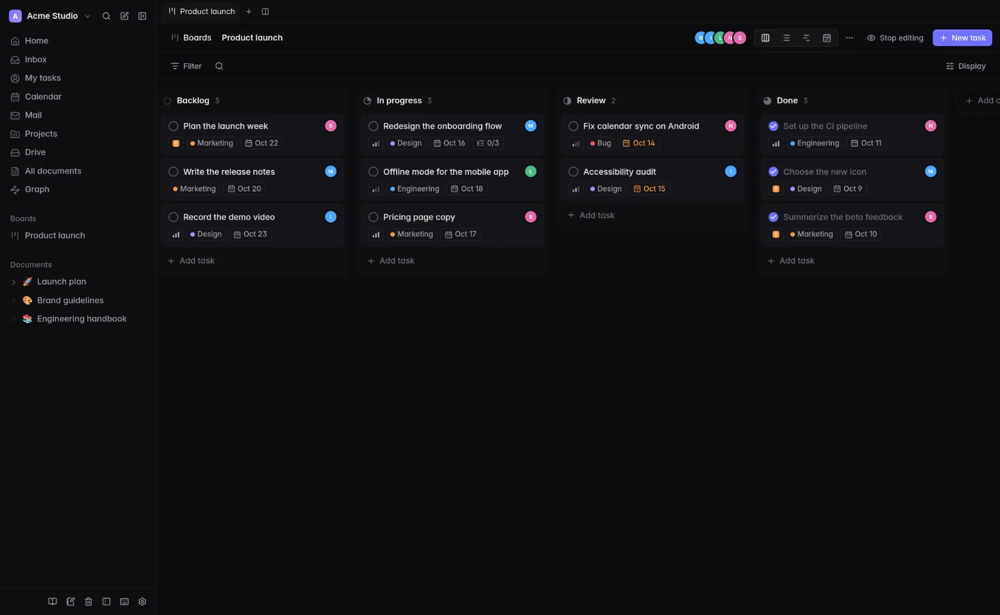

<p align="center">
  
</p>

<h1 align="center">Looty</h1>

<p align="center">
  Tasks, documents and calendar for your team, in one calm place.<br>
  Free, open source and self-hosted, with apps for Android, Linux and Windows that work offline.
</p>

<p align="center">
  <a href="https://looty.untypequicode.fr">Website and downloads</a> ·
  <a href="RELEASING.md">Releasing</a> ·
  <a href="LICENSE">GPL-3.0</a>
</p>

<p align="center">
  
</p>

## What it does

- **Boards and tasks**: kanban, list, timeline and calendar views; assignees, labels, priorities, due dates, sub-tasks and per-person validation.
- **Documents**: collaborative editing with live cursors, formulas (LaTeX), diagrams, tables, code and embeds; share by link or with chosen people.
- **Calendar**: events and recurrence, a calendar per board, CalDAV subscriptions and a CalDAV server; task due dates appear on it.
- **Mail**: read your mailbox next to your work and turn a message into a task.
- **Projects**: small websites, LaTeX documents and Jupyter notebooks running Python in the browser.
- **School**: connect Moodle to see deadlines, courses and messages beside your own tasks.
- **Teams**: fine-grained roles, read-only members, guests, single sign-on (OpenID Connect), activity feed, notifications.
- **Offline apps**: Android, Linux and Windows keep your data on the device, let you edit offline and sync back.

English and French, light and dark themes.

## Apps

Download them from **<https://looty.untypequicode.fr>** (or the [GitHub releases](../../releases)). Each app asks for the address of *your* Looty server.

| Platform | Notes |
|---|---|
| Android 8+ | Native Kotlin app, no Google services (UnifiedPush), widget, share target, offline editing, updates inside the app |
| Linux | `.deb` for Debian 12 / Ubuntu 22.04+ with a signed apt repository (`apt upgrade` updates it); Nix package (`nix run github:untypequicode/looty#looty-desktop`) |
| Windows 10/11 | Installer for the current user (unsigned: Windows may warn about an unknown publisher) |
| iPhone / iPad | Open Looty in Safari and add it to the home screen (installable web app) |

## Self-hosting

Looty is three small services plus PostgreSQL, shipped as Docker images (amd64 and arm64):

| Service | Role | Stack |
|---|---|---|
| `backend` | API, files, CalDAV, mail | Rust (axum) |
| `frontend` | Web interface | Nuxt 3 |
| `collaboration` | Real-time document editing | Hocuspocus (Yjs) |

1. Get the compose file of the latest release and create a `.env` next to it:

   ```sh
   curl -LO https://github.com/untypequicode/looty/releases/latest/download/docker-compose.yml
   curl -o .env https://raw.githubusercontent.com/untypequicode/looty/main/.env.example
   ```

2. Edit `.env`: the domain (`APP_DOMAIN`, `BASE_URL`), database password, `LOOTY_SECRET_KEY` (`openssl rand -base64 32`) and your OpenID Connect provider (`OIDC_ISSUER`, `OIDC_CLIENT_ID`, `OIDC_CLIENT_SECRET`).
3. `docker compose up -d`.

The production compose file expects a [Traefik](https://traefik.io) reverse proxy to route the domain (labels are in the file); behind another proxy, send `/api`, `/uploads`, `/pages`, `/dav` and `/.well-known/caldav` to the backend (8080), `/collab` to the collaboration service (8082, prefix stripped) and everything else to the frontend (3000). Pin a version with `LOOTY_VERSION=<x.y.z>`.

Backups: `scripts/backup.sh` and `scripts/restore.sh`.

## Repository

```
backend/         Rust API (axum, PostgreSQL); release notes in releases.json
frontend/        Nuxt 3 single-page app
collaboration/   Hocuspocus server for real-time documents
desktop/         Tauri v2 app (Linux, Windows) and Debian packaging
android/         Native Android app (Kotlin, Compose)
site/            Download website (Astro + a tiny Rust server)
scripts/         Release, backup and site publishing scripts
```

## Development

A Nix shell provides every toolchain: `nix-shell` (or `nix develop`).

```sh
docker compose up -d postgres          # database
cd backend && cargo run                # API on :8080
cd frontend && npm install && npm run dev   # web app on :3000
cd collaboration && npm install && node index.js
```

`docker compose up` (without Traefik) builds and runs everything from source. Backend tests: `cargo test` in `backend/`. Each app has its own README: [`desktop/`](desktop/README.md), [`android/`](android/README.md), [`site/`](site/README.md).

## Releasing

Bump the version, add the notes (English and French) to `backend/releases.json` and merge into `main`: CI builds and publishes what changed. Details in [RELEASING.md](RELEASING.md).

## License

[GPL-3.0](LICENSE).
